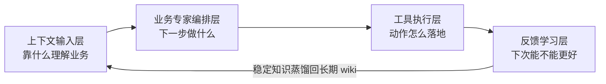
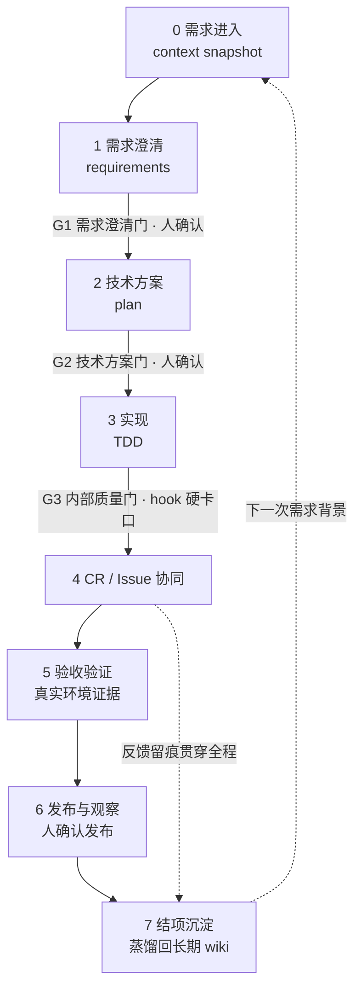

# reqflow

> 端到端业务需求 Agent 工作流：把 PRD 到上线的完整研发过程，组织成 Agent 能自主推进、人只在关键节点确认的闭环。

[](./LICENSE)
[](https://nodejs.org)
[](./CONTRIBUTING.md)

AI 写代码本身已经不是瓶颈。**代码之外的串联成本**才是：上下文反复梳理、平台来回切换、反馈留在聊天框里蒸发、下一次需求又从零开始。

`reqflow` 把这套串联成本系统化：定义 4 层能力架构、8 个阶段闭环、3 道质量门禁，配套可移植的 skill 模板、产物模板、机器可读的工作流规范和一个**零依赖** CLI。框架无关——它可以被 Claude Code / Cursor / OMP / 自研 Agent 加载，也可以只当作团队研发规范使用。

## 核心思路



三个工程化问题，对应四层能力：

| 问题 | 层 | 回答 |
|---|---|---|
| 上下文能不能被组织起来 | 上下文输入层 | 按阶段拉取长期业务知识、需求材料、代码事实、运行证据 |
| 工具能不能被串起来 | 工具执行层 | 需求平台 / 代码与 CR / 配置 / 日志监控 / 文档变成可调用能力 |
| 反馈能不能产生复利 | 反馈学习层 | 评论、验收、人工修正选择性蒸馏回长期知识 |
| 流程能不能可复现 | 业务专家编排层 | 阶段判断、门禁判定、回退与人工介入决策 |

## 纵向闭环：一个需求怎么走完



| # | 阶段 | 主要产物 | 人工介入 |
|---|---|---|---|
| 0 | 需求进入 | `context-snapshot.md` | 仅事实源缺失 / 材料冲突时 |
| 1 | 需求澄清 | `requirements.md` | **G1 确认需求表达是否准确** |
| 2 | 技术方案 | `plan.md` | **G2 确认方案与验收方式** |
| 3 | 实现 | 测试先行的代码 + commit | G3 由 git hook 自动执行 |
| 4 | CR / Issue 协同 | CR 评论、milestone 回刷 | 在 CR 上评论反馈 |
| 5 | 验收验证 | `verification.md` 证据 | 独立环境通过后确认发布 |
| 6 | 发布与观察 | 变更材料、观察记录 | **发布动作由人执行** |
| 7 | 结项沉淀 | `closeout.md` + 蒸馏候选 | 确认稳定知识与 skill 改进 |

三道**质量门禁**是 G1 / G2 / G3；发布确认是独立的人工审批门，不算质量门。G3 不靠提示词自觉，而是 `git pre-push` hook——不做就推不上去。

```
reqflow/
├── workflow/workflow.json       # 唯一事实源：层 / 阶段 / 门禁 / 产物
├── workflow/workflow.schema.json
├── skills/                      # 8 个阶段的可移植提示词模板
├── templates/                   # 7 份过程产物模板
├── hooks/pre-push               # 内部质量门禁的硬卡口
├── bin/reqflow.mjs              # 零依赖 CLI
├── scripts/selfcheck.mjs        # 端到端自检
├── docs/                        # 架构 / 闭环 / 门禁 / 记忆模型 / 接入
└── examples/demo-requirement/   # 完整走一遍的示例
```

## 快速开始

```bash
git clone https://github.com/webxiongda/reqflow.git
cd reqflow

npm run selfcheck                       # 校验规范 + CLI 冒烟 + 门禁正反例
node bin/reqflow.mjs validate           # 校验 workflow.json
node bin/reqflow.mjs init my-feature    # 生成需求工作区
cd my-feature && node ../bin/reqflow.mjs status
```

安装成全局命令：

```bash
npm link
reqflow validate
reqflow init my-feature --hooks
```

## 接入自己的 Agent

1. 把 `workflow/workflow.json` 作为阶段与门禁的事实源；Agent 每轮先问「当前在哪个阶段、下一个门禁是什么」。
2. 把 `skills/<阶段>/SKILL.md` 注册成 Agent 的 skill 或 system prompt，占位符在工作区初始化时替换。
3. 在代码仓库运行 `reqflow hooks install`，把 G3 绑到 `git push`。
4. 结项时按 `templates/closeout.md` 生成蒸馏候选，人工确认后再写入长期 wiki。

详见 [`docs/adoption.md`](./docs/adoption.md)。模板不绑定任何平台；文中出现的 Aone / SLS / HSF 只是示例工具槽位。

## 设计原则

- 上下文先行：事实不全时回退补上下文，而不是让 Agent 猜。
- 门禁前置：验收标准在方案阶段就定死，不留到实现完再补。
- 测试定义正确行为：先写测试再写代码，测试不是覆盖率装饰。
- 反馈留痕：评论、验收、修正落在可追溯平台，不只留在聊天框。
- 不直接升级：过程材料先留项目记忆，结项人工确认后才进长期 wiki。

## License

[MIT](./LICENSE)
