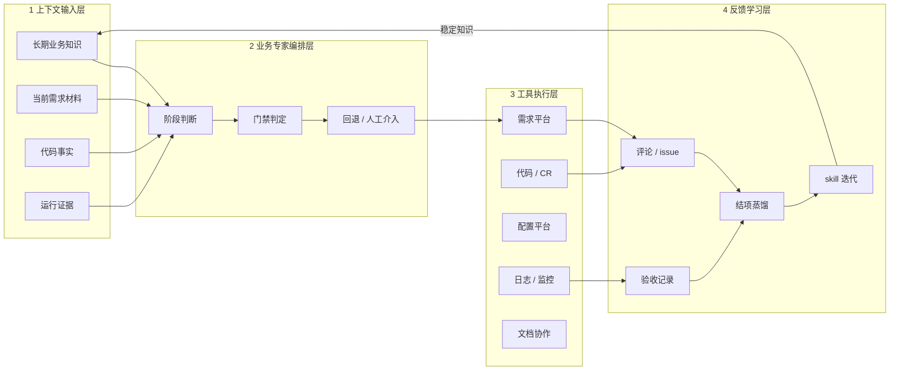

# 四层架构

静态能力地图。四层不是并列模块，而是从事实输入、阶段判断、工具落地到反馈回收的闭环。

## 各层职责

| 层 | 回答的问题 | 关键约束 |
|---|---|---|
| 上下文输入层 | Agent 靠什么理解业务 | 不是把资料一次性塞进 prompt，而是按阶段拉取与组织 |
| 业务专家编排层 | 下一步该做什么 | 阶段、门禁、回退判断可复现，不能每次靠人盯 |
| 工具执行层 | 具体动作怎么落地 | 平台能力按阶段可调用，不依赖人工切网站 |
| 反馈学习层 | 下次能不能更好 | 反馈必须落盘；结项时选择性蒸馏，否则系统无状态 |

## 为什么上下文层单独存在

Agent 表现不好，多数时候不是模型不会推理，而是拿到的上下文不完整。需求文档、用户澄清、历史口径、代码事实、配置状态、日志、人的经验原本分散在不同地方。上下文错了，后面越努力越偏。

具体做法见 [`memory-model.md`](./memory-model.md)：三仓库分工 + 「不直接升级」原则。

## 为什么编排层要显式建模

下面这些判断如果都靠人盯着，成本高且不可复现：

- 需求当前在澄清、方案还是实现阶段？
- 哪些地方必须停下等人确认？哪些可以继续自主推进？
- 证据不足时，是回退补上下文，还是直接请求人工介入？

`workflow/workflow.json` 把这些判断变成数据：每个阶段有 `layer`、`gate`、`autonomous`、`stopWhen`，Agent 每次推进前读它，而不是靠记忆。

## 工具执行层不是平台绑定

`stages[].tools` 写的是**能力槽位**（`cr-comments`、`log-query`、`config-cli`），不是具体产品名。接入时把槽位映射到自己的 CLI / API 即可。原文里的 Aone、SLS、HSF、天机星只是其中一种落地。

## 反馈学习层贯穿全程

它不只在结项时工作：CR 评论、验收证据、人工修正从需求进入就开始积累。结项只是集中兑现——把稳定知识蒸馏到长期 wiki，把反复出现的流程问题变成 skill / prompt 改进候选。
