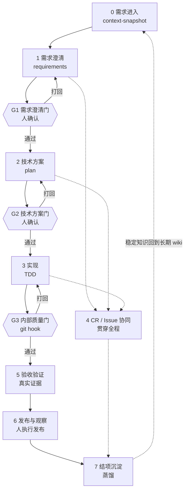

# 纵向闭环：一个需求怎么走完

四层架构是静态能力地图，本文回答「一个需求实际上怎么走完」。每个阶段按需调用横向各层能力：上下文组织阶段主要在输入层，澄清和方案依赖编排层判断，实现与验收密集调用工具层，反馈学习层贯穿始终、在结项时兑现。

## 0. 需求进入

Agent 先拿两类已存在信息：

- **当前需求材料**：工作项、PRD、issue 评论、用户补充说明——回答「到底要做什么」。
- **长期业务知识**：wiki、codemap、历史口径、系统边界——回答「怎么快速理解业务」。

组合成初始上下文快照 `context-snapshot.md`。后续 requirements / plan / progress 是流程推进中逐步产生的，不需要在进入阶段备齐。

正常不需要人工；只有事实源缺失或材料冲突时停下。

## 1. 需求澄清（G1）

有上下文快照不等于真的理解需求。把初始上下文整理成可审阅的 `requirements.md`：目标行为、非目标边界、验收标准、风险、待确认问题。

人确认的不是零散回答，而是「这份 requirements 是否准确表达需求」。确认前不进入方案；确认后的 requirements 是 plan、实现、验收的共同基准。

**协作留痕**：反馈落到 CR 评论体系而非聊天框，既是当前推进依据，也是结项沉淀素材。

## 2. 技术方案（G2）

回答的是一组完整问题：现状、目标行为、不做什么、影响范围、核心改动点、风险、验证方式、回滚方案。

关键设计：**方案阶段就把验收定清楚**。验收方式、测试策略、验证入口写进 plan；正例 / 反例 / 回归三类场景提前定义；配置类需求提前创建 schema 并校验，让实现时对着 schema 写代码、验收时对着 plan 逐项核对。

## 3. 实现与内部质量（G3）

在已确认的 requirements 和 plan 范围内自主改代码、补测试、提交 commit。核心决策是 **TDD 驱动**：

> AI 写测试最常见的失败模式不是写不出来，而是为了覆盖率写——先写完代码再补一堆只验证代码能跑通的测试。真正有价值的 TDD 反过来：先按 plan 里的验收标准写测试，让测试定义「什么是对的」，再让实现满足测试。

从本地到远端之间有 Agent 自己的硬门禁，不靠提示词自觉，而是 `git pre-push` hook：

| 检查 | 说明 | 失败处理 |
|---|---|---|
| diff-to-test 映射 | 每处生产代码行为变化都要有测试锚点 | 回到 execute 补测试 |
| lint / PMD | 规则类问题自动化捕获 | 修完重跑 |
| unit test | 全量单测必须通过 | 修完重跑 |
| self review | 对待 push diff 做结构化检查 | 有 actionable 问题就修、重跑、再 review |

## 4. CR / Issue 协同

评论协作从需求进入就开始了，最密集的阶段恰恰是澄清和方案，而不是代码实现。Agent 主动读取 unresolved 评论 → 修改文档或代码 → 提交新 commit → 回复并 resolve。涉及语义或范围变更时回退到 requirements / plan 重新确认，不在当前层面硬改。

重大节点通过 milestone 评论回刷，每条带 commit link、CR link 和验证证据。

## 5. 验收验证

单元测试通过不等于业务做对。用**独立项目环境**而不是共享预发：部署 feature 分支，通过服务泛化调用验证业务行为、日志查询验证输出、监控验证运行时指标。

验收标准来自 requirements 和 plan，至少覆盖正例、反例、回归三类。证据写入 `verification.md`，供 CR 审阅和结项引用。独立环境通过后、进入主预发或线上前，仍有人工确认门。

## 6. 发布与变更观察

发布材料（变更说明、风险评估、回滚预案）由 Agent 协助准备，**发布动作由人确认和执行**。上线不是终点：观察期内继续回读日志、检查运行时指标、确认业务行为；异常进入结项复盘素材。

## 7. 结项沉淀

回看整个需求，回答三个问题：

| 分类 | 内容 | 去向 |
|---|---|---|
| 稳定知识 | 业务规则、系统边界、验收规范、排障经验 | 经 CR 确认后进入长期 wiki / codemap |
| 流程改进 | Agent 在哪犯错、走弯路、被反复纠正 | skill / 提示词迭代候选 |
| 仅归档 | 一次性实现细节、临时调试记录、中间状态 | closeout raw log，审计底稿 |

项目记忆的 feature 分支合并回主干；长期 wiki 变更走独立 CR。人工确认后，稳定知识成为下一个需求进入时的背景来源，闭环合上。
