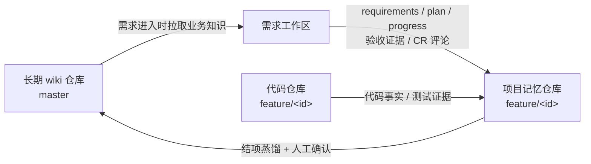
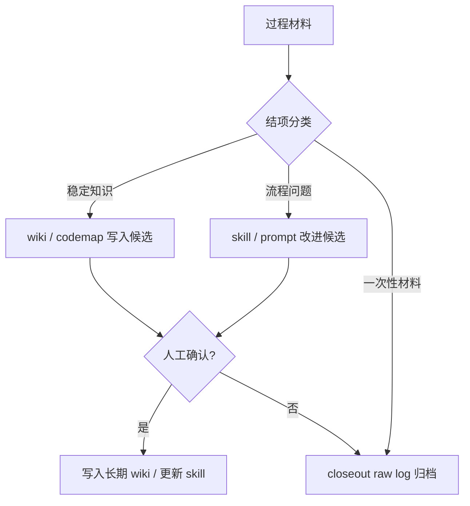

# 三仓库记忆模型

上下文不是「一次性塞满 prompt」，而是按阶段组织。落地时拆成三个仓库，职责和分支策略都不同。

| 仓库 | 分支 | 装什么 | 生命周期 |
|---|---|---|---|
| 代码仓库 | `feature/<requirement-id>` | 生产代码与测试 | 需求结束后合并 / 删除分支 |
| 项目记忆仓库 | `feature/<requirement-id>` | requirements、plan、progress、验收证据、CR 评论 | 结项时合并回主干 |
| 长期 wiki 仓库 | `master` | 稳定业务规则、系统边界、验收规范、排障经验 | 长期保留，独立 CR 审阅 |

## 关键原则：不直接升级

需求过程中产生的事实**先留在项目记忆层**。只有经过结项审视和人工确认，才选择性进入长期知识。

两个好处：

1. 避免噪声污染长期 wiki——一次性的实现细节、临时调试记录不该变成下个需求的「背景知识」。
2. 每次结项都真正筛出有复用价值的东西，而不是把聊天记录倒进知识库。

## 每个阶段读什么、写什么

| 阶段 | 从 wiki 读 | 写入项目记忆 |
|---|---|---|
| 需求进入 | 业务知识、codemap、历史口径 | `context-snapshot.md` |
| 需求澄清 | 相关历史口径 | `requirements.md` + 确认评论 |
| 技术方案 | 系统边界、历史方案 | `plan.md` + 配置 schema |
| 实现 | 验收规范 | `progress.md`（TDD 记录、门禁结果） |
| CR 协同 | — | `decision-log.md`（评论与 resolve 记录） |
| 验收 | 排障经验 | `verification.md`（证据） |
| 结项 | — | `closeout.md` + 蒸馏候选 |

## 蒸馏判断的三类

- **稳定知识**：业务规则、系统边界、验收规范、排障经验——下个类似需求不需要重新学。经 CR 确认后写入长期 wiki / codemap。
- **流程改进**：Agent 在哪个环节犯错、走弯路、被人工反复纠正——变成 skill / 提示词迭代候选。若多次需求重复出现，就不该继续靠人盯着。
- **仅归档**：一次性实现细节、临时调试记录、中间状态——留在 closeout raw log 当审计底稿，不进长期知识。

`reqflow init` 生成的工作区只包含项目记忆层文件。长期 wiki 的写入必须是独立 CR + 人工确认，CLI 不会自动改 wiki。
