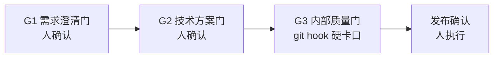
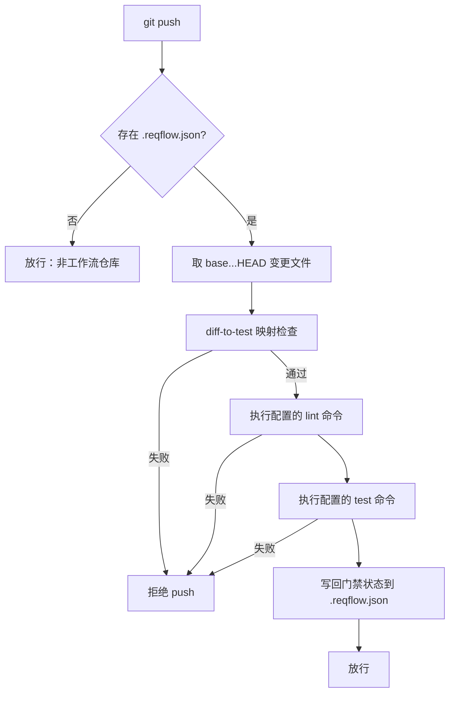

# 三道质量门禁

门禁不是「提醒 Agent 注意」，而是「不满足就不能往下走」。三道质量门 + 一道独立的人工发布审批。



| 门禁 | 阶段 | 类型 | 谁把关 | 不通过时 |
|---|---|---|---|---|
| G1 需求澄清 | `clarify` | quality | 人，在 CR 上确认 | 回到澄清补上下文 |
| G2 技术方案 | `plan` | quality | 人，在 CR 上确认 | 回到方案修订 |
| G3 内部质量 | `execute` | quality | git pre-push hook | 回到实现修复，重跑门禁 |
| 发布确认 | `release` | approval | 人，确认并执行发布 | 停在发布准备，Agent 不自动发布 |

## G1 / G2：把人放在正确位置

人工确认最密集的地方是澄清和方案，不是代码实现。原因很简单：需求理解对了、方案确认了，代码阶段 Agent 不需要那么多微操。

确认的对象是**一份可审阅的产物**，不是聊天框里的一堆回答：

- G1 看 `requirements.md`：目标行为、非目标边界、验收标准、风险、待确认问题。
- G2 看 `plan.md`：现状 / 目标 / 影响范围 / 改动点 / 风险 / 回滚 / 验收方式 / 配置 schema。

两道门都要求反馈留在 CR 评论里。这既是当前推进依据，也是结项时判断「哪些澄清反复出现」的素材。

## G3：从提示词变成工程卡口

这是整套设计里最容易被低估的一点。**提示词约束不可靠**——再怎么写「push 前必须跑 lint」，Agent 在复杂任务中仍可能跳过。真正的解法是把它变成绕不过去的 git hook。

```bash
reqflow hooks install
```

安装后，每次 `git push` 自动执行 `hooks/pre-push`：



### diff-to-test 映射

只要求「跑了一遍模块回归」不算证据。每个被改动的生产文件都要找到对应测试锚点：

- `src/foo/bar.ts` → `src/foo/bar.test.ts` 或 `bar.spec.ts`
- `src/main/java/.../UserService.java` → `UserServiceTest.java`

测试文件与源文件同名（含 `Test` / `.test` / `.spec` 后缀）或位于 `__tests__` / `src/test` 目录。可在 `.reqflow.json` 的 `quality.sourceGlobs` / `quality.testGlobs` 里改。

### 配置示例

```json
{
  "quality": {
    "enabled": true,
    "base": "HEAD~1",
    "sourceGlobs": ["src/**/*.{ts,tsx,js,jsx,java}"],
    "testGlobs": ["**/*.{test,spec}.{ts,tsx,js,jsx}", "**/__tests__/**", "src/test/**"],
    "commands": {
      "lint": "npm run lint",
      "test": "npm test"
    }
  }
}
```

`commands` 留空字符串表示「未配置，跳过并告警」——不会给你虚假的通过感。接自己的项目时填真实命令。

### self review

PMD / lint 之后，Agent 对完整待 push diff 做结构化 review：发现 actionable 问题就修、重跑、再 review。这一步由 `skills/03-execute/SKILL.md` 约束，产物写入 `progress.md` 的「self review 记录」。hook 负责前三项机械检查，review 是 Agent 的判断环节。

## 为什么发布不算质量门

发布是**审批**，不是质量判定：独立环境验收通过后，主预发 / 线上发布仍需人确认和执行。Agent 只准备变更材料和回滚预案，并在观察期继续回读日志与指标。把审批混进质量门会模糊责任边界。
